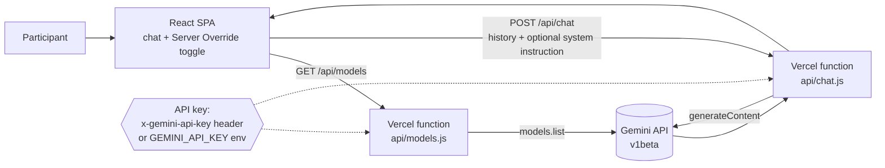

<p align="center">
  
</p>

<p align="center">
  
  
  
  
  
</p>

**Aura Security Lab** is a small red-teaming lab for studying how Google Gemini models respond to adversarial prompts. You chat with a Gemini model and flip a single **Server Override** switch to add a known prompt-injection style system instruction, so you can compare the model's behaviour with and without it in the same conversation. It was built as a hands-on demo for a KIIT IoT Lab cybersecurity event, to teach how jailbreaks work and why model-level alignment matters.

## How it works



- **One-switch A/B testing.** With Server Override off, prompts go to the model as-is. With it on, `src/api.ts` attaches an adversarial `systemInstruction`, and a red banner shows that the jailbreak instruction is active.
- **Measures the model, not the filter.** Every request sets Gemini's adjustable safety categories to `BLOCK_NONE`, so a refusal comes from the model's own alignment rather than from the API's content filter.
- **Keys stay out of the browser bundle.** The SPA only calls `/api/models` and `/api/chat`. Those serverless proxies use a key supplied by the user in the `x-gemini-api-key` header, or fall back to `GEMINI_API_KEY` set on the server.
- **Live model discovery.** `/api/models` lists the models that support `generateContent`. The client ranks them by tier (pro > flash > lite) and version, and falls back to a built-in list (Gemini 3.1 and 2.5) if discovery fails. The default model is `gemini-3.1-pro-preview`.
- **Multi-turn conversations.** The `useChat` hook keeps the conversation in the browser and sends the full history with each turn. Replies render as Markdown (GFM). Clear Context starts a fresh session.

## Quick start

Requires Node.js 18+ and a Gemini API key from [Google AI Studio](https://aistudio.google.com/app/apikey).

```bash
git clone https://github.com/NamanSingh69/Gemini-Jailbreak.git
cd Gemini-Jailbreak/frontend
npm install
```

The `/api/*` routes are Vercel serverless functions, so run the full app with the Vercel CLI (it asks you to log in and link a project the first time):

```bash
# optional server-side fallback key (.env is git-ignored)
echo "GEMINI_API_KEY=your-key-here" > .env
npx vercel dev
```

`npm run dev` starts the Vite UI alone on http://localhost:5173. Chat and model discovery need the `/api` functions, so they won't work in that mode. In the UI, paste your key into **Gemini API Access**, pick a model, and send a prompt. Press Ctrl+Enter to send.

| Script | What it does |
|---|---|
| `npm run dev` | Vite dev server on port 5173 (UI only) |
| `npm run build` | Production build to `dist/` |
| `npm run preview` | Serve the production build on port 5173 |
| `npx vitest run` | Unit tests for the `useChat` hook, with the API layer mocked |
| `npx playwright test` | Playwright browser specs in `e2e/` |

## API

| Route | Method | Purpose |
|---|---|---|
| `/api/models` | GET | Proxies the Gemini `v1beta/models` list |
| `/api/chat` | POST | Proxies `generateContent`. Body: `model`, `contents`, optional `systemInstruction`, `generationConfig`, `safetySettings` |

Both routes read the optional `x-gemini-api-key` header first, then `GEMINI_API_KEY` (or `VITE_GEMINI_API_KEY`) from the environment.

## Project layout

```
frontend/              Deployable app (Vercel)
  api/                 Serverless proxies: chat.js, models.js
  src/api.ts           Model ranking, request building, system instruction
  src/hooks/useChat.ts Conversation state and multi-turn history
  src/App.tsx          Settings panel, model picker, chat UI
  e2e/                 Playwright specs
  vercel.json          Build settings and SPA rewrite
backend/               Earlier FastAPI version (not used by the frontend)
  app.py               /api/send, /api/history, /api/models, /healthz; system prompt kept server-side
  Dockerfile           Container for Render
```

## Deploy

Import the repo into Vercel, set **Root Directory** to `frontend`, and add `GEMINI_API_KEY` as an environment variable. `vercel.json` already sets the Vite build, the `dist` output folder and the SPA rewrite.

## Responsible use

This project is for security education and authorized model evaluation. The system instruction is a publicly known prompt-injection pattern. It is included so people can see how such attacks are built, why they sometimes work, and why guardrails need defence in depth. Use it only with your own API keys, follow Google's [Gemini API terms](https://ai.google.dev/gemini-api/terms), and report real model vulnerabilities through responsible disclosure.

## License

[MIT](LICENSE) © Naman Singh
